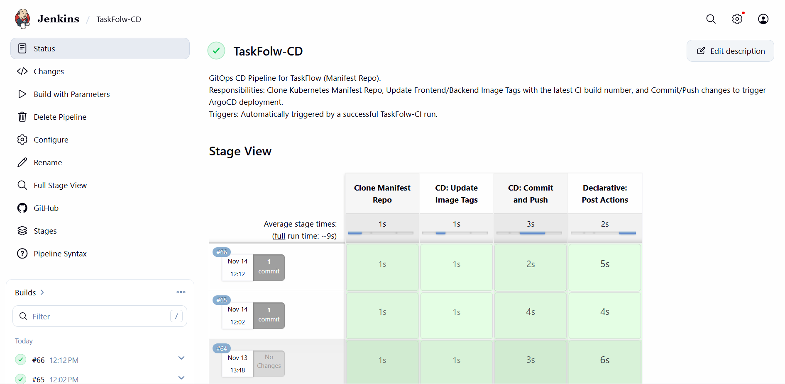
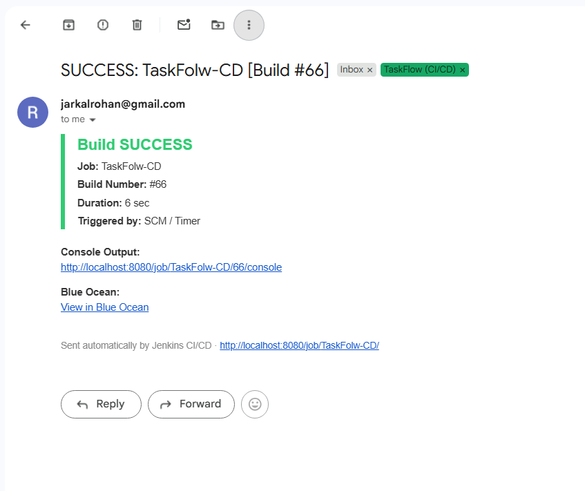

# ☸️ TaskFlow - Kubernetes GitOps Deployment

This repository contains the Kubernetes manifests for the [TaskFlow application](https://github.com/jarkalrohan-bit/TaskFlow.git). It uses a **GitOps** workflow managed by **ArgoCD**.

## 📂 Repository Structure
- `backend/`: Deployment and Service for the Flask API.
- `frontend/`: Deployment and Service for the React/Nginx frontend.
- `database/`: StatefulSet, Service, and PVC for PostgreSQL.
- `argocd/`: ArgoCD Application definition.
- `kustomization.yaml`: Aggregates all manifests for ArgoCD.

## 🚀 How GitOps Works Here
1. The **CI Pipeline** builds new Docker images and pushes them to Docker Hub.
2. The **CD Pipeline** (Jenkins) updates the image tags in this repository's YAML files and pushes the commit.
3. **ArgoCD** detects the Git commit, syncs the manifests to the cluster, and performs a rolling update.

## 🔄 CD (Continuous Delivery / Continuous Deployment)
The Jenkins CD pipeline automatically updates Kubernetes manifests when a new image is built by the CI pipeline.



### 📧 CD Pipeline Notifications

The CD pipeline is fully automated and sends email alerts upon success or failure, including direct links to the Blue Ocean view and console logs.



## 🛠️ Deployment Instructions

### Prerequisites
- A running Kubernetes cluster (Kind, Minikube, or EKS/GKE).
- ArgoCD installed in the cluster.

### Apply the ArgoCD Application
If you need to register this app in ArgoCD for the first time:
```bash
kubectl apply -f argocd/application.yaml
```

## 🌐 Accessing the Application Locally

Since the Kubernetes services are configured with the `ClusterIP` type, use `kubectl port-forward` to access the application locally for testing and verification.

### 1. Access the Frontend

Run the following command to forward local port `8080` to the frontend service:

```bash
kubectl port-forward svc/taskflow-frontend 8080:80 -n taskflow
```

Once port-forwarding is active, open the application in your browser:

* **Frontend URL:** http://localhost:8080

### 2. Access the Backend API

Open a separate terminal and run the following command to forward local port `5000` to the backend service:

```bash
kubectl port-forward svc/taskflow-backend 5000:5000 -n taskflow
```

Verify the backend health endpoint:

* **Backend API Health Check:** http://localhost:5000/api/health

---

## 🧹 Cleanup

To remove the ArgoCD application and clean up the associated Kubernetes resources, follow these steps:

### 1. Delete the ArgoCD Application

Run the following command to delete the ArgoCD application:

```bash
kubectl delete -f argocd/application.yaml
```

### 2. Remove the Kubernetes Namespace

If the namespace and its resources are not automatically removed by ArgoCD, delete the namespace manually:

```bash
kubectl delete namespace taskflow
```

> **Note:** Deleting the namespace removes its associated Kubernetes resources, including `PersistentVolumeClaims` (PVCs). Depending on your storage configuration, the underlying persistent data may also be deleted.

---

## 📌 Important Notes

* **GitOps Best Practice:** Do not modify Kubernetes resources directly in the cluster using `kubectl edit`. Make all configuration changes in the Git repository and let ArgoCD synchronize them with the cluster.
* **Database Credentials:** Database credentials are securely managed using Kubernetes Secrets. The secret is named `taskflow-db-secret`.
* **Resource Management:** Ensure that Kubernetes resources are managed through the GitOps workflow to maintain consistency between the Git repository and the cluster configuration.
#